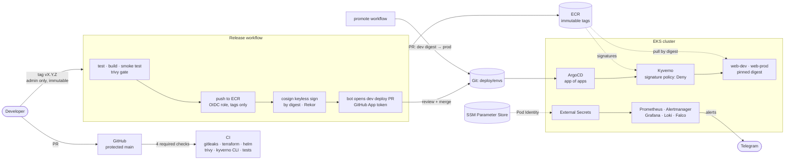

# devops-platform

A hardened Kubernetes platform on AWS EKS where **only reviewed, scanned and signed code can run**, and the platform proves it with every deploy.

Everything is code: Terraform builds the infrastructure, ArgoCD deploys the platform and the app from Git, GitHub Actions builds and signs releases, and a 45-check `verify.sh` confirms that each layer is doing its job, not just reporting "Healthy". The whole environment is created from scratch and destroyed after each session (~20 minutes up, ~$0.30 per hour while it runs).

## Highlights

| Claim | Proof |
| --- | --- |
| **Unsigned images cannot run** | A/B test on the live cluster: the same pod spec in the same namespace was **denied** with an unsigned image from our own ECR repository and **admitted** with the release-signed one. `verify.sh` also fails if any app pod is older than the signature webhook. |
| **Prod runs the exact bytes dev tested** | Promotion copies dev's image **digest** into prod by pull request. Nothing is rebuilt. |
| **Rollback in under a minute** | Drill: promotion live in **80 s**, rollback by reverting the PR in **49 s**, zero downtime both ways, visible in Grafana. |
| **No secrets in terminals, Git or Terraform state** | The cluster pulls them from SSM Parameter Store through External Secrets, with a read-only Pod Identity role scoped to one path and one namespace. |
| **Deterministic install order** | CRDs before operators, policies ready before app pods: ArgoCD sync waves that wait for health, after a real race condition was diagnosed and fixed (see [Incidents](#incidents-found-and-fixed)). |

## Architecture



## The security chain

From a commit to a running pod, each step has one control and blocks one class of problem:

| Stage | Control | What it stops |
| --- | --- | --- |
| Source | Ruleset on `main`: PR + 4 required checks, branch up to date | unreviewed or untested code reaching `main` |
| Source | Actions pinned by SHA, Dependabot, gitleaks on full history | supply-chain drift in CI, leaked secrets |
| Release | Tag creation admin-only, tags immutable (separate rulesets, negative-tested) | rewriting what a released version means |
| Release | Release must be on `main`; tests and smoke test run on the **production** image | releasing unreviewed or broken builds |
| Image | Pinned base digest, pip removed, non-root, read-only rootfs, all caps dropped; Trivy gate on fixable HIGH/CRITICAL | known-fixable CVEs, tooling an attacker could use |
| Registry | GitHub OIDC → IAM role trusted for `refs/tags/v*` only; ECR tags immutable, scan on push | long-lived AWS keys, overwriting a released tag |
| Signature | cosign keyless (GitHub OIDC identity, Rekor transparency log), signed **by digest** | anyone else producing a "valid" image |
| Deploy | Bot PRs for dev, promotion PRs for prod, both through CI and review | untracked changes to what runs where |
| Admission | Kyverno `ImageValidatingPolicy`: identity must be `release.yaml@refs/tags/vX.Y.Z`, fail-closed | images pushed by hand, even to our own ECR |
| Admission | Pod Security `restricted` + Kyverno policies (registry allow-list, no `:latest`, read-only rootfs) | insecure pod specs |
| Runtime | Falco (modern eBPF) | shells and suspicious activity inside containers |
| Secrets | External Secrets + SSM, Pod Identity, `/devops-platform/*` read-only, store limited to `monitoring` | static keys, secrets in Git or in Terraform state |

## Install order

ArgoCD's app-of-apps creates the platform in waves. Each wave starts only when every app in the previous one is **Healthy**, which requires a custom health check for `Application` objects (removed from ArgoCD's defaults in 1.8) and one for Kyverno's `ImageValidatingPolicy`. Both are in `platform/bootstrap/argocd-values.yaml`.

| Wave | Apps | Why here |
| --- | --- | --- |
| -2 | `project-platform`, `project-web` | AppProjects before any app that uses them |
| -1 | `prometheus-crds`, `external-secrets` | CRDs and the secrets operator first |
| 0 | `kyverno`, `monitoring`, `secrets`, `falco`, `loki`, `alloy` | operators find their CRDs; Grafana and Alertmanager find their Secrets |
| 1 | `policies`, `dashboards` | policies exist before any app pod |
| 2 | `web-dev`, `web-prod` | start only when the signature policy reports **ready** |

## Incidents found and fixed

These came from running the platform for real, not from reading docs. Each one ended with a fix and an automated check.

| Symptom | Root cause | Fix |
| --- | --- | --- |
| Half of all `kubectl` calls took 16 s | One of the two EKS API endpoint IPs was unreachable from the admin's network; clients waited for a timeout, then fell back. Proven per IP with `curl --resolve` after ruling out the token, DNS and API discovery. | `scripts/eks-endpoint-pin.sh` tests every endpoint IP and pins a reachable one in `/etc/hosts` **only if** one is dead; `verify.sh` checks every IP. |
| `monitoring` stuck in `Progressing` for 80 min | The Prometheus Operator started 1 s before its CRD existed, disabled that controller and never retried. ArgoCD sync waves were not waiting for health at all. | CRDs in their own app (wave -1), `crds.enabled: false` in kube-prometheus-stack, and an `Application` health check so waves really wait. Proven: CRD → operator 5 m 41 s apart on the next run. |
| First app pods started before the signature policy | Same root cause: waves did not wait. | Web apps moved to wave 2 behind an `ImageValidatingPolicy` health check; `verify.sh` fails if any app pod predates the webhook. |
| Alerts silently not delivered, while the test said "delivered" | A doubled paste of the Telegram token; the test checked a counter that only increases after all retries. | Token format + `getMe` validation; the test now reads the per-attempt failure counter and uses a unique alert per run. |
| `verify.sh` reported "11 minutes" for one section | One `kubectl logs` call per pod, sequentially, over a long network path. | One list call, then parallel reads with a timeout each: ~2 minutes for the whole script. |

## Design decisions

| Decision | Trade-off |
| --- | --- |
| **SSM Parameter Store** instead of Secrets Manager | Free (standard tier, AWS-managed key) and enough here; Secrets Manager adds automatic rotation and cross-account sharing for $0.40 per secret per month. Switching is one line in the store. |
| **Pod Identity** instead of IRSA | No OIDC provider per cluster; trust policies restricted by `aws:SourceAccount` and `aws:SourceArn` to this cluster. |
| Kyverno **Deny** for signatures, **Audit** for the other policies | Signature enforcement is the line that matters; the others warn and report until all workloads comply, then can move to Enforce. |
| Promote by **digest copy**, roll back by **PR revert** | Every change to prod, including the rollback, is reviewed, tested by CI and recorded in Git history. |
| Ephemeral cluster, persistent registry and secrets | Separate Terraform stacks: `infra/eks` is created and destroyed each session; `infra/registry`, `infra/bootstrap` and the SSM parameters stay. |
| Health checks for ArgoCD waves | Ordering becomes guaranteed; the cost is that a stuck app visibly blocks later waves instead of failing silently. |

## What production would change

This is a lab built to learn and to demonstrate, so some choices favor cost and simplicity. In production:

- Private API endpoint behind a VPN or SSM, instead of a public endpoint restricted to one `/32`.
- NAT per availability zone and on-demand capacity for system workloads, instead of one NAT and Spot nodes.
- Persistent storage for Loki and Prometheus, plus long-term metrics storage.
- Remaining Kyverno policies in Enforce, plus a Falco rule for denied reads.
- Customer-managed KMS keys for ECR and secrets, ECR lifecycle rules that keep signature artifacts, and VPC endpoints for AWS APIs.
- Dependency lock files with hashes and a distroless base image.
- Terraform plan on PR and apply on merge, instead of applying from the admin's machine.

## Repository layout

```text
app/                Python service (stdlib HTTP + Prometheus metrics), tests, hardened Dockerfile
charts/web/         Helm chart: image by digest, probes, ServiceMonitor
deploy/envs/        dev and prod values (changed only by bot and promotion PRs)
infra/bootstrap/    budget alarm (persistent)
infra/registry/     ECR repository + GitHub OIDC release role (persistent)
infra/eks/          VPC, EKS, Pod Identity roles for Kyverno and External Secrets (per session)
platform/root.yaml  ArgoCD app of apps
platform/apps/      one Application per platform component, with sync waves
platform/policies/  Kyverno policies, including the signature policy
platform/secrets/   ClusterSecretStore + ExternalSecrets
platform/dashboards Grafana "Web releases" dashboard
scripts/            up, down, verify, secrets-init, endpoint pin, cost check
.github/workflows/  ci, release, promote
```

## Operating it

| Step | Command | Notes |
| --- | --- | --- |
| Secrets (once) | `./scripts/secrets-init.sh` | stores the Telegram bot token (validated) and a random Grafana password in SSM Parameter Store. They persist across clusters; External Secrets syncs them in. `--rotate-grafana` / `--rotate-telegram` to replace. |
| Bring up | `./scripts/up.sh` | ~20 min. Checks the SSM secrets exist first, then asks nothing. Pins the API endpoint only if one of its IPs is unreachable. |
| Wait | `watch -n 10 'kubectl get applications -n argocd'` | until all 13 apps are **Synced / Healthy**; they appear wave by wave |
| Verify | `./scripts/verify.sh` | **Run it ~5 minutes after everything is Healthy.** Right after install, Helm hook jobs are still finishing and the Prometheus Operator logs webhook `bad certificate` errors until its certificate is patched in (install-time, stops on its own). |
| Release | `git tag -a vX.Y.Z -m "…" && git push origin vX.Y.Z` | admin only; opens the dev deploy PR automatically |
| Promote | `gh workflow run promote.yaml -f version=X.Y.Z` | refuses if dev does not run that version; opens a PR copying dev's exact digest to prod |
| Roll back | `gh pr revert <promotion PR>` | merge it: ArgoCD returns prod to the previous digest |
| Tear down | `./scripts/down.sh` then `./scripts/aws-cost-check.sh` | always: the cluster costs money per hour |

## Stack

EKS 1.37 · Terraform 1.17 · ArgoCD · Kyverno · Falco · kube-prometheus-stack · Loki · Alloy · External Secrets · cosign · Trivy · gitleaks · GitHub Actions · Helm
